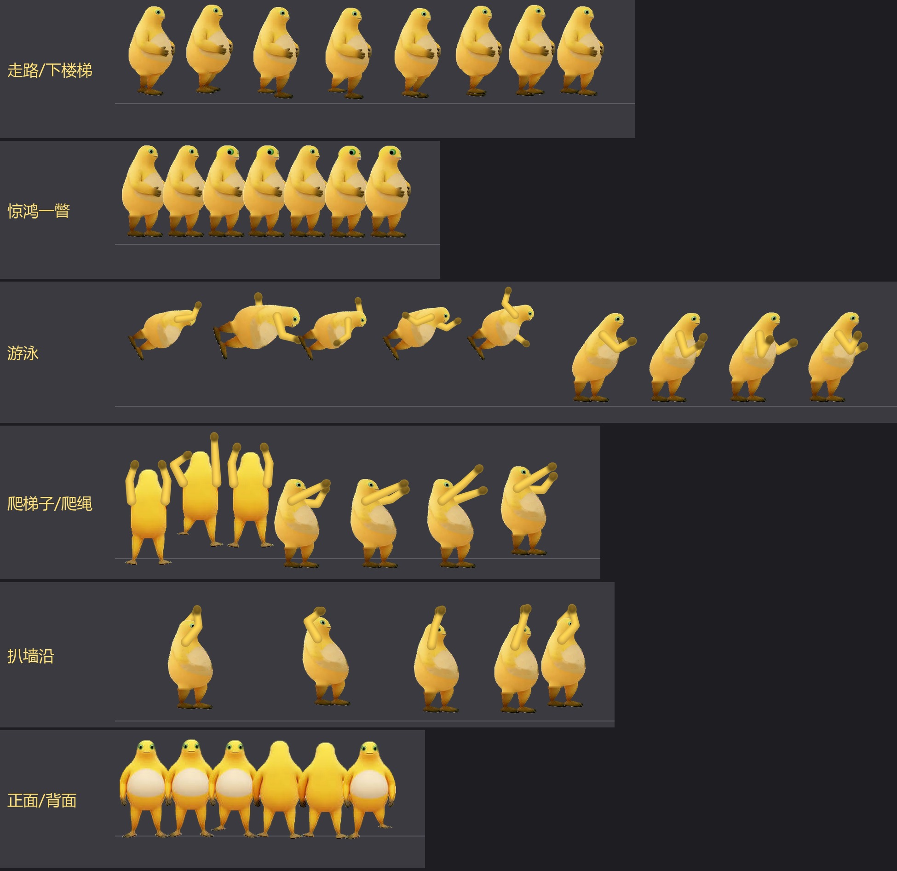

# Silver Pines 奶蛙 mod + CE 修改表

单机游戏 **Silver Pines**（Wych Elm / Team17，Unity 6000.3.15f1，IL2CPP）的两个 mod：

- **奶蛙主角**：把主角换成胖胖的黄色奶蛙，走路、跑步、举枪、近战、游泳、攀爬都有对应动作，待机时会做「惊鸿一瞥」表情。
- **Cheat Engine 修改表**：无敌、无限弹药、一击必杀等 12 项功能，给手残党用。

*A frog ("奶蛙") player-model replacement and a Cheat Engine table for the single-player game Silver Pines.
The repository contains no game files: the mod is generated from your own copy of the game.*



## 奶蛙主角 mod

### 有什么

- 主角约 2000 帧动画全部重画成奶蛙：位置、高度、身体倾斜都跟着原角色走。
- 走路时两条腿跟着原角色的脚迈步，侧面看两腿从同一个胯部摆动，不会交叉。
- 举枪、换弹、瞄准时用没有手的身体，配上奶蛙颜色的手臂，不会出现原来的人。
- 挥砍、刀、投掷等近战动作：奶蛙的手会伸到武器握把上。
- 跑步摆臂；游泳时自由泳划水，踩水时双手在胸前划圈。
- 爬梯子显示背面并双手交替往上抓；爬绳双手抓绳；扒墙沿时手一直抓着边。
- 朝镜头走、进门、楼梯转身时用奶蛙的正面 / 背面（根据三视图生成）。
- 站着待机时每个循环（约 3 秒）斜眼瞥一次「惊鸿一瞥」，左右张望看镜头时也会。

### 生成

仓库里没有游戏文件，mod 要用你自己的游戏生成（约 13 分钟）。

1. 安装 Python 3.12 和依赖：

   ```bash
   pip install -r requirements.txt
   ```

2. 游戏不在 `D:\Games\Silver Pines` 的话，先在命令提示符里设置环境变量 `SILVER_PINES`，指向游戏文件夹（里面有 `Carpenter.exe`）：

   ```bat
   set SILVER_PINES=C:\Program Files (x86)\Steam\steamapps\common\Silver Pines
   ```

3. 生成主资源包和补丁资源包：

   ```bash
   python -P -E scripts/frogify.py main frogmod/build/team17_auto_base_characters_compressed_assets_player.bundle
   ```

   ```bash
   python -P -E scripts/frogify.py patches frogmod/build/patches
   ```

4. （可选）检查生成结果：

   ```bash
   python -P -E scripts/verify_frog_bundle.py frogmod/build/team17_auto_base_characters_compressed_assets_player.bundle check.png 40
   ```

### 安装 / 卸载

- 安装：**先退出游戏**，双击 `frogmod/install_frog.bat`。游戏不在默认位置时，把游戏文件夹拖到这个 bat 文件上。
  第一次安装会把原版文件备份到 `frogmod/backup/`。
- 卸载：退出游戏，双击 `frogmod/restore_original.bat`，恢复原版主角。
- 游戏更新后：先卸载，删掉 `frogmod/backup/`，再重新生成和安装。`_dump/` 里的数据对应当前版本，
  更新后补丁资源包的文件名可能会变，需要用 `scripts/` 里的扫描脚本重新生成。

### 改奶蛙的图

奶蛙的分层图已经在 `frogmod/parts/` 里。想换图的话：

1. `scripts/cutout.py`：去掉白底，得到 `frogmod/frog_cutout.png`。
2. `scripts/frog_parts.py`：切成身体、手臂、腿等图层。
3. `scripts/frog_views.py`：从 `frogmod/source/` 里的三视图和表情包生成正面、背面和「惊鸿一瞥」的头。

## CE 修改表

需要 [Cheat Engine](https://www.cheatengine.org/) 7.4 或更新版本。

1. 启动游戏，进到主菜单。
2. 打开 Cheat Engine，点左上角的电脑图标，选择 `Carpenter.exe`。
3. 打开 `SilverPines.CT`，**先勾选第一项「激活 Silver Pines 修改器」**，再勾选想要的功能。

功能：无敌、不死（致命伤自动回满血）、无限体力、无限弹药、近战武器不掉耐久、一击必杀、必定打中弱点、
电器电量不减、花钱不减少、修改金钱、地图全显示、万能钥匙。

所有地址都靠特征码查找，并在写入前校验 IL2CPP 类名；游戏版本对不上时会直接提示，不会乱改内存。

## 目录

| 路径 | 内容 |
|---|---|
| `SilverPines.CT` | CE 修改表 |
| `scripts/frogify.py` | 奶蛙 mod 生成器（主程序） |
| `scripts/frog_parts.py`, `frog_views.py`, `cutout.py` | 从奶蛙原图生成图层 |
| `scripts/clip_map.py`, `clip_curves.py`, `scan_*.py` | 分析游戏动画，生成 `_dump/` 里的数据 |
| `scripts/verify_*.py`, `showcase.py`, `*_probe.py` | 检查和预览 |
| `scripts/disasm.py`, `xrefs.py`, `aobcheck.py`, … | 做 CE 表时用的分析工具（需要 Il2CppDumper 的输出） |
| `frogmod/` | 安装 / 卸载脚本、奶蛙原图和分层图 |
| `MODLOG.md` | 开发记录：游戏内部结构、每个版本改了什么 |

## 声明

- Silver Pines 版权归 Wych Elm / Team17 所有。本仓库不含任何游戏文件；生成的资源包只用于你自己的游戏，请不要分发。
- 奶蛙图片来自网络（表情包），版权归原作者所有，如有侵权请联系删除。
- 用到的工具：[UnityPy](https://github.com/K0lb3/UnityPy)、[Il2CppDumper](https://github.com/Perfare/Il2CppDumper)、
  [AddressablesTools](https://github.com/nesrak1/AddressablesTools)、[Cheat Engine](https://www.cheatengine.org/)、
  OpenCV、Pillow、NumPy、capstone。
- 代码、脚本和 CE 表由 AI 编写：Anthropic 的 Claude（Claude Opus 5.5，通过 Claude Code）。
- 代码和 CE 表使用 [MIT 许可证](LICENSE)；奶蛙图片不在许可范围内。
